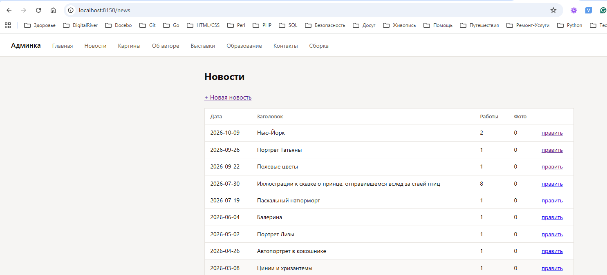
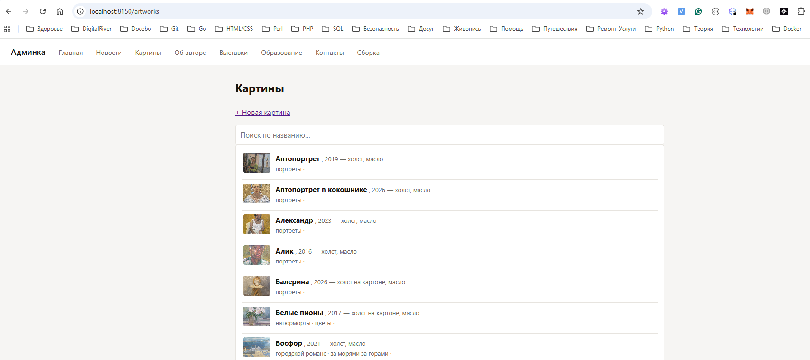
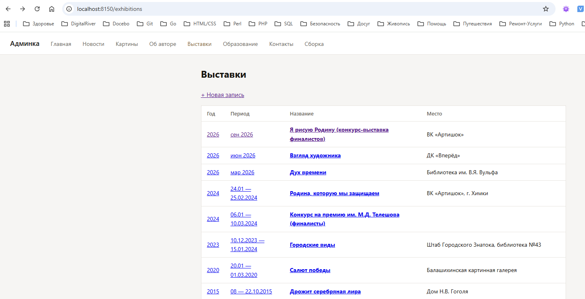
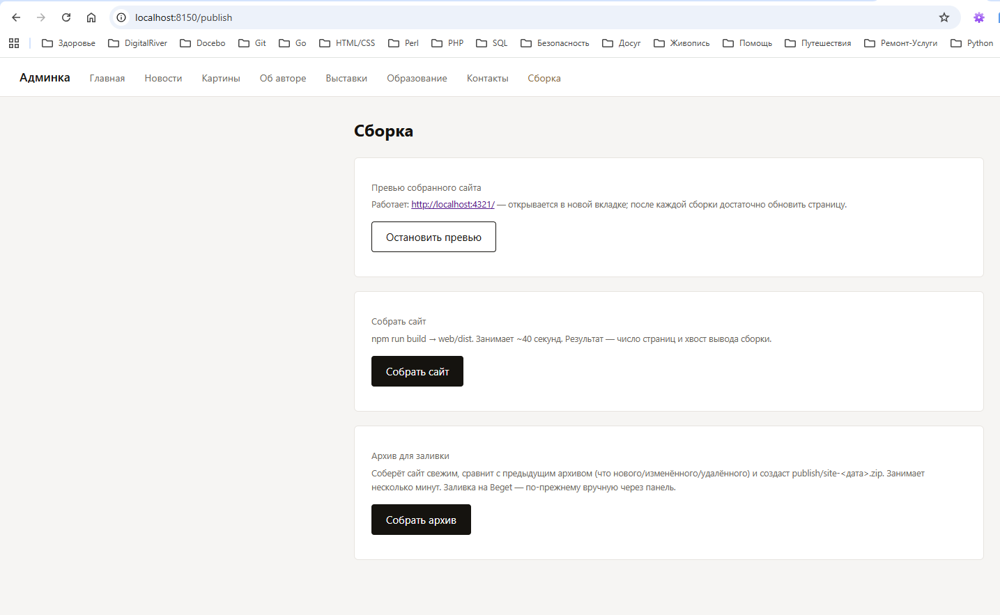

# Painter

A static artist portfolio template: a gallery with categories, news, an about
page, exhibitions and contacts. The site is fully static — there is no server
side, and the result runs on any hosting, including cheap shared plans.

**Live example built from this code:** https://eromanova.ru

[Русская версия](README.ru.md)

## Stack

- **Astro 5** — static site generation (SSG); no client-side JS framework
- **Go** (standard library only) — tooling: an artwork catalog importer and a
  local admin panel
- **Content** — plain JSON files, no database
- **Images** — WebP variants and `srcset` are generated at build time

## Features

- Gallery: categories, series («See also» blocks on artwork pages), an
  «Available» badge, manual ordering inside a category
- Artwork page: lightbox with prev/next navigation within the section,
  WebP/srcset
- News with pagination
- SEO: Open Graph, sitemap, JSON-LD, alt texts
- Accessibility: Lighthouse 100 (a11y)
- Self-hosted fonts, no external CDNs — the site makes no third-party requests

## Repository layout

```
web/                    the site (Astro)
  src/pages/            pages and routes
  src/components/       components
  src/layouts/          base layout
  src/lib/              helpers
  src/content/          content as JSON: artwork catalog, news, about,
                        education, exhibitions, contacts (your own data,
                        not part of the repository)
  src/content/template/ placeholder content files — copy these and fill
                        them with your own data
  src/assets/artworks/  original artwork scans (not included in the repo)
  public/               static files: favicons, robots.txt
tools/
  catalogimport/        artwork importer: sha256 dedup, catalog.json generation
  admin/                local admin panel: content forms, spell checker,
                        build, publish archive, preview
scripts/                PowerShell: admin panel launcher, publish packing
.claude/skills/painter/ Claude Code skill: an operational guide to this
                        repository (structure, running, checks, publishing)
images/                 admin panel screenshots (used in the READMEs)
```

## Requirements

- Node.js 20+ with npm — for the site itself
- Go 1.14+ — for the importer and the admin panel (the site builds fine
  without Go)
- Windows 10/11 — for the PowerShell scripts and the admin panel; the site
  (dev/build) works on any platform

## Getting your own site running, step by step

### 1. Clone and install

```
git clone https://github.com/lenarn/painter.git
cd painter/web
npm install
```

### 2. Prepare your artwork scans

Create one folder per gallery category — the folder name becomes the category
name on the site. A subfolder inside makes a compound category
(`paintings/oils`). Put the same scan into several folders to give one artwork
several categories; duplicates are detected by file hash, so it stays a single
catalog entry.

### 3. Import the artworks

From the repository root (the output paths are the defaults):

```
go run ./tools/catalogimport "landscapes" "portraits"
```

List your own folder names instead. The tool:

- copies unique files into `web/src/assets/artworks`, renamed by content hash;
- regenerates `web/src/content/catalog.json` — new works get skeleton entries
  with `needs_metadata: true`;
- keeps a `.bak` backup of the previous catalog and preserves the metadata of
  works it already knows (matched by hash), so re-running is safe.

The catalog is rebuilt from your folders, so whatever was in `catalog.json`
before (including the entries shipped with the template) is replaced with your
works in one run.

### 4. Copy the content templates

The content files (news, the about page, education, exhibitions, contacts,
afisha events) are not part of the repository — they hold the site owner's
personal data. Copy the placeholders from `web/src/content/template/` into
`web/src/content/` and replace the text with your own:

```
copy web\src\content\template\news.json web\src\content\
copy web\src\content\template\about.json web\src\content\
copy web\src\content\template\education.json web\src\content\
copy web\src\content\template\exhibitions.json web\src\content\
copy web\src\content\template\contacts.json web\src\content\
copy web\src\content\template\afisha.json web\src\content\
```

(`catalog.example.json` stays where it is — it is only a schema reference;
`catalog.json` itself is generated by the importer in step 3.)

Two more personal bits the code expects:

- put your portrait at `web/src/assets/about/photo1.jpg` (it is imported by
  the About page; the path is easy to change in `src/pages/about.astro`)
- set your domain in `web/astro.config.mjs` (`site:`) — it drives canonical
  URLs, og:url and the sitemap

### 5. Run the dev server

```
cd web
npm run dev
```

Open http://localhost:4321 — the gallery shows your categories and artworks
under generated names like `artwork-a1b2c3d4e5`.

### 6. Fill in artwork metadata

For each entry in `web/src/content/catalog.json` (or via the admin panel):

| Field | Meaning |
|---|---|
| `title`, `year`, `technique` | shown on the artwork page |
| `dimensions` | real size, e.g. `{ "w": 54, "h": 70, "unit": "см" }` |
| `caption` | text under the artwork |
| `alt` | image alt text |
| `featured` | show on the home page |
| `available` | «Available» badge (work is for sale) |
| `sort` | manual position inside a category, per category name |
| `related` | list of other artworks' slugs — builds a «See also» series |

### 7. Build and deploy

```
cd web
npm run build
```

The result is in `web/dist/`. Copy its contents into the web root of your
hosting — the site is static, nothing else is required.

## Admin panel (optional, Windows)

The admin panel is a small local web app (Go, standard library only) for the
everyday content work — no need to edit JSON by hand.

Start it (the script builds the panel from source with Go and opens
http://localhost:8150 in your browser; stop it with Ctrl+C in its window):

```
powershell -ExecutionPolicy Bypass -File scripts\start-admin.ps1
```

It is strictly local — nothing is published anywhere from the panel itself.

What you can do with it:

- **Edit content through forms**: the artwork catalog (titles, techniques,
  dimensions, captions, ordering, related works), news posts, and the About,
  Education, Exhibitions and Contacts pages
- **Check spelling** of drafts (Yandex Speller API)
- **Run the site**: build it and start a preview on http://localhost:4321
  (if the port is busy, whatever runs there is stopped first)
- **Prepare a publication**: build the site and pack
  `publish/site-<date>.zip` with a change report vs. the previous archive —
  how many files were added, modified or deleted, and whether the hosting
  web root should be cleaned before unpacking

The admin panel: news, artworks, exhibitions and the build page.

|  |  |
|---|---|
|  |  |

## Afisha — the «Where to go» block on the home page

One admin page curates a small block on the home page with upcoming
exhibitions and lectures: tick the events you want from the found lists,
or add your own entries with the form on the same page — no external
services involved. Past events are hidden automatically at build time
(by their dates), so the selection only needs pruning rarely.

The optional «Run agent search» button on that page asks Claude Code
(headless) to sweep Moscow museum listings and drop fresh events into
`exhibitions/` and `lectures/` in the repository root, where the tick
list takes them from. It needs Claude Code installed and the
`exhibition-scout` agent shipped in `.claude/agents/` (part of this
repository, used with the repository root as your project directory).
Without Claude Code the button just reports that — the rest of the Afisha
page, including manual entries, works as usual. Your personal
`web/src/content/afisha.json` stays out of the repository like all other
content.

## Deploy as an archive

`scripts\publish-pack.ps1` builds the site and packs
`publish/site-<date>.zip` (the dist contents at the archive root) plus a text
manifest. Unzip into the hosting web root (e.g. `public_html` on shared
hosting).

## Images and the repository

`web/src/assets/artworks/` is in `.gitignore` — your image files are not
committed; remove that line if you want to keep them in git. The content JSON
files in `web/src/content/` are ignored for the same reason: they hold the
site owner's personal data. Because of this a fresh clone shows an empty site
until you run the importer with your own folders (step 3) and copy the
content templates (step 4).

The favicon is personal too: `web/public/favicon.png` (32x32) and
`web/public/apple-touch-icon.png` (180x180) are in `.gitignore` — put your own
cropped artwork there. Until they exist the build links `web/public/favicon.svg`,
a neutral placeholder committed to the repository.

## License

[MIT](LICENSE) — project code.